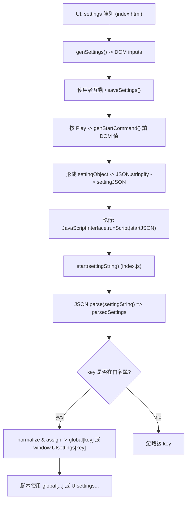

# Mermaid1 流程圖：index.html → index.js 設定傳遞

下面的 Mermaid 圖示化 `index.html`（UI）到 `index.js`（start 解析與寫入）的流程。

> 在 VS Code 中使用你安裝的 Markdown Preview Mermaid 擴充：打開此檔案，按 Ctrl+Shift+V（或右鍵 -> Open Preview）以預覽圖形。



---

快速說明：
- 如果要匯出成圖片或 SVG，你可以另外建立一個純 mermaid 的 `.mmd` 檔並使用 mermaid-cli（或擴充功能）來輸出。

範例（可選）在 PowerShell 安裝與輸出命令：

```powershell
# 安裝 mermaid-cli（需 Node.js/npm）
npm install -g @mermaid-js/mermaid-cli

# 假設你建立 diagram.mmd，輸出 PNG
mmdc -i diagram.mmd -o diagram.png
```

說明結束，若你要我把圖另存成 SVG/PNG，我可以再幫你產生對應檔案或把 Mermaid 圖內嵌到 README。