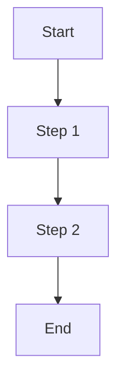
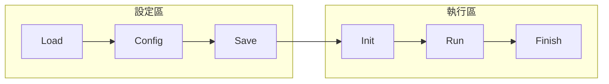
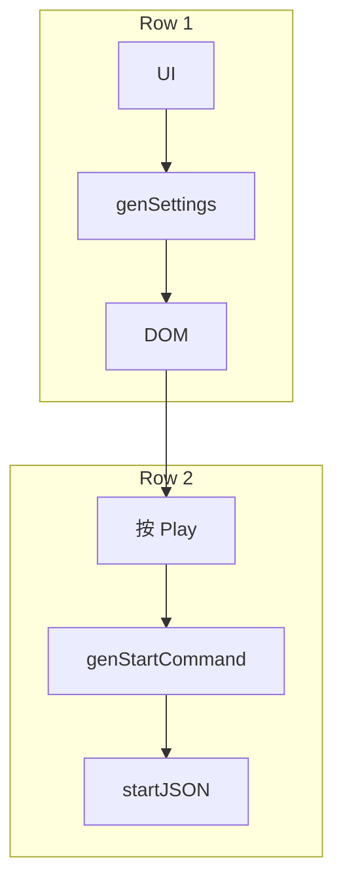
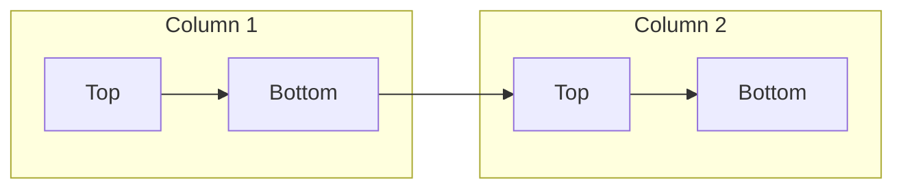
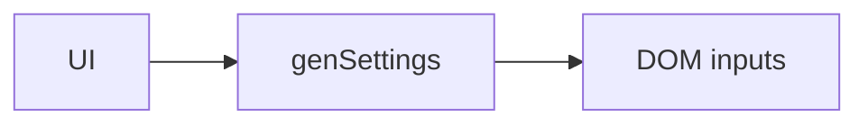
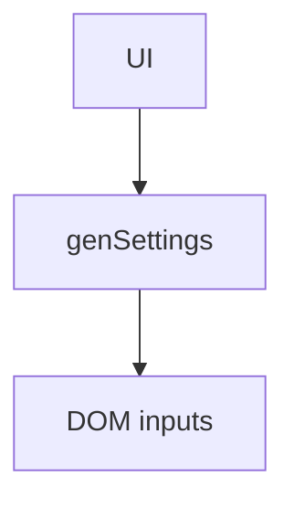
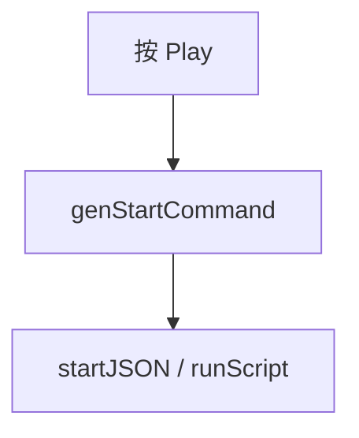
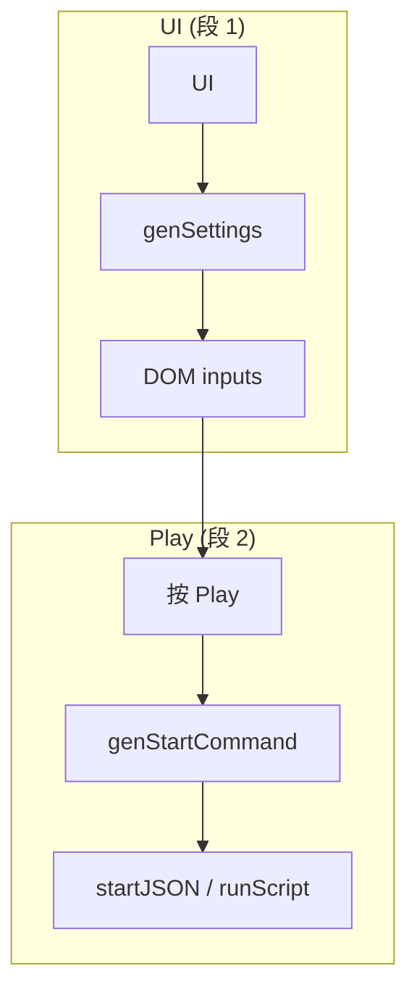
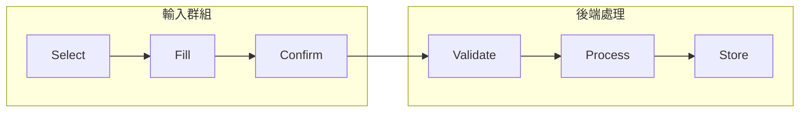

# Mermaid 方向與 subgraph 範例（TD / TB / LR）


這個檔案收錄你要的簡單教學與多個可直接貼到 Markdown 的 Mermaid 範例：
- 說明 TD/TB 與 LR 差別
- 範例：TD、TB（相同）、LR
- subgraph 拆段、在 subgraph 內改方向、分段多個 code block
- 匯出與預覽建議（mermaid-cli）

---

## 1. 簡短說明
- `TD` 與 `TB`：Top → Down（上到下），`flowchart TD` 與 `flowchart TB` 等效。
- `LR`：Left → Right（左到右），`flowchart LR`。

VS Code 的 Markdown Preview 會把整張圖縮放以 fit 到預覽面板，如果圖是非常寬（例如 LR 一行很多節點），它會整體縮小，導致看起來非常小。若要更可讀，建議改用 TD/TB 或拆成子圖（subgraph）／多段 Mermaid 區塊，或匯出高解析圖檔。

---

## 2. 可直接貼到 Markdown preview 的範例

### 2.1 Top → Bottom（TD / TB） — 垂直排列


> 註：`flowchart TB` 效果等同於 `flowchart TD`，可任選。


### 2.2 Left → Right（LR） — 水平排列（可能太寬）


> 若節點多，整圖會變很寬，Preview 會縮放整圖以 fit 寬度，導致看起來很小。


### 2.3 用 `subgraph` 拆段（保留左右關係，但子圖內垂直排列）


這樣每個子圖會豎直排列，整體仍維持左右關係，且不會像單行 LR 那麼寬。

### 2.3a 左右分區換行（多列 / 換行）
下面列出三種常見做法，可以在 VS Code Preview 中達成「左右分區但分行換列」的視覺效果，依用途選擇：

- 方法 1（推薦）：外層使用 TB（垂直），每個子圖當成一個水平列（subgraph 內用 LR）。這樣可把整體切成多列，Preview 會把每列放大，易讀性最好。



- 方法 2：維持外層 LR（左右主區），但在每個 column 內放多個小 subgraph（direction TB）來堆疊成上下兩段。這對保留「左右兩大區」語意有用。



- 方法 3：將流程拆成多個 Mermaid code block（每段一張圖），在 Markdown 中垂直排列，適合非常長或語意分段明顯的流程。




方法 3 的優點是每段都能在 Preview 中放大，缺點是看起來不是單一連續圖（需要讀者按順序看多張圖）。

小結：若想同時保留左右分區語意又不被縮得很小，方法 1（外層 TB、子圖 LR）通常最直覺；若想保留左右主區但內部要多行，方法 2 可在 column 內用 TB 堆疊。


### 2.4 拆成多個 Mermaid 區塊（每段一張圖）




把流程拆成小段有助於在 Preview 中放大閱讀。

## 新增：換行並保留連線的三種解法
下面把之前提到的三個解法完整列在此（可直接複製到 VS Code preview）：

1) 推薦（單一 Mermaid Block + subgraph + TB 外層） — 看起來像分成兩段但可以畫實線連接


說明：part1 與 part2 各自橫向排列（子圖內用 LR），整體上下排列（外層用 TB），可以用 `C --> D` 畫出跨段連線，預覽時會把兩段放大且連線可見。

2) 保持獨立 Block（兩個 Mermaid block）+ 文字標示關聯 — 最簡單但沒有真連線


(Markdown 文字)

↓ （C → D）


說明：兩個 block 各自渲染為獨立 SVG，無法跨 block 畫線；用 Markdown 文字或相同標號作為提示可以讓讀者理解流程延續。

3) 高階：匯出圖檔後合成（PNG/SVG）並手動或程式化繪線 — 最美但工作量最大

說明：把每段用 mermaid-cli 匯出成高解析圖片，然後用圖像工具或簡單的 HTML/CSS/SVG 把圖片放在同一畫布上再畫連線，適合要放在投影片或文件的最終版面。

示意流程（無程式碼）：
- 產生 diagram1.png, diagram2.png
- 用圖像編輯器或 HTML 把兩張圖放在合適位置
- 用向量工具或 SVG path 畫出連線，輸出最終圖檔


## 3. 進階：subgraph 與方向混用範例



## 4. 匯出為 PNG/SVG（mermaid-cli）
若要產出不受 Preview 縮放影響的高解析圖檔，可以使用 mermaid-cli（需要 Node.js/npm）：

```powershell
# 在 PowerShell 安裝 mermaid-cli
npm install -g @mermaid-js/mermaid-cli

# 假設你把上面某個 Mermaid 區塊存成 diagram.mmd
mmdc -i diagram.mmd -o diagram.png -w 2000
# -w 指定寬度（像素），可按需求調整
```

或輸出 SVG：
```powershell
mmdc -i diagram.mmd -o diagram.svg
```


## 5. 快速建議（Summary）
- 如果想在 VS Code Preview 直接看清楚，優先改 `flowchart TD`（或 `TB`）或把圖拆成 subgraph / 多段 block。 
- 若要放到文件或投影片，匯出成 PNG/SVG 並指定寬度會得到最穩定的視覺效果。

---

如果你要我直接把你現有的 `mermaid_diagram_1.md` 改為 `flowchart TB`、或把它拆成 2 段（每段一個 block），或幫你產生 `.mmd` 並嘗試用 mermaid-cli 匯出 PNG，我可以幫你做（需要你允許我執行匯出，或我會提供命令讓你在本機執行）。
  subgraph B["後端處理"]
    direction TB
    B1[Validate] --> B2[Process] --> B3[Store]
  end

  A3 --> B1
```


## 4. 匯出為 PNG/SVG（mermaid-cli）
若要產出不受 Preview 縮放影響的高解析圖檔，可以使用 mermaid-cli（需要 Node.js/npm）：

```powershell
# 在 PowerShell 安裝 mermaid-cli
npm install -g @mermaid-js/mermaid-cli

# 假設你把上面某個 Mermaid 區塊存成 diagram.mmd
mmdc -i diagram.mmd -o diagram.png -w 2000
# -w 指定寬度（像素），可按需求調整
```

或輸出 SVG：
```powershell
mmdc -i diagram.mmd -o diagram.svg
```


## 5. 快速建議（Summary）
- 如果想在 VS Code Preview 直接看清楚，優先改 `flowchart TD`（或 `TB`）或把圖拆成 subgraph / 多段 block。 
- 若要放到文件或投影片，匯出成 PNG/SVG 並指定寬度會得到最穩定的視覺效果。

---

如果你要我直接把你現有的 `mermaid_diagram_1.md` 改為 `flowchart TB`、或把它拆成 2 段（每段一個 block），或幫你產生 `.mmd` 並嘗試用 mermaid-cli 匯出 PNG，我可以幫你做（需要你允許我執行匯出，或我會提供命令讓你在本機執行）。
